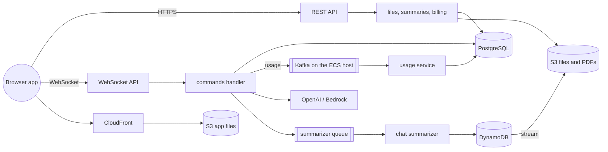

# Summaries.AI

> This repository publishes the documentation of a private codebase; a script or source
> file the documents name is not here.

A web app where people and an LLM think together. Several people chat with the model in one
shared context and see each other's messages and its answers as they arrive; after every turn
the app writes a summary of the chat so far, keeps it as a PDF, and makes it searchable by
meaning. It is built for individuals who sign in with Google, each paying for their own use:
users bring their own PDFs for the model to draw on, and pay with credit bought through Stripe.

The app runs at https://d7cx4qnodzsdl.cloudfront.net.

**Contents:** [Overview](#overview) · [Tech stack](#tech-stack) · [Architecture](#architecture) ·
[Getting started](#getting-started) · [Scripts](#scripts) · [Details](#details)

## Overview

- **Sign in with a Google account.** Each user's chats, files and balance are their own.
- **Chat with the model together.** Start a chat with a question and continue it turn by turn;
  answers appear in every open window of every participant. A chat is private, shared with
  chosen users, or public.
- **Choose the model per chat** from a catalog of OpenAI GPT and Anthropic Claude models, each
  with its own price. The model can look up the current weather and the forecast on its own.
- **A summary after each turn.** A summary of the whole chat is written in the background, kept
  as a PDF with rendered code blocks and diagrams, and shared by a link that expires after a day.
- **Search chats** by meaning (the default) or by keywords.
- **Bring your own documents.** Upload PDF and text documents once; every later question is
  answered with the relevant parts of them in the model's context (retrieval-augmented
  generation, RAG below).
- **Prepaid credit.** Start with $1, then buy $20 or $60 packages; each answer's cost is
  deducted at the model's price. The interface is in English or Hebrew, and works on a phone.

## Tech stack

- **Backend** — Node.js 24 Lambdas in TypeScript, the shared logic in Lambda layers, behind
  API Gateway: a WebSocket API and a REST API for the browser, and a REST API by API key that
  answers other services' RAG queries
- **Data** — PostgreSQL for chats, users and usage; DynamoDB for summaries; S3 for files and
  PDFs; Redis for caching and each user's open WebSocket connections; Pinecone for embeddings
- **Model** — OpenAI and Amazon Bedrock (Claude), chosen per chat; OpenAI
  `text-embedding-3-small` embeddings; weather tools the model may ask the backend to run
- **Messaging** — SQS for messages to the browser and for summarizing; Kafka for usage, on the
  one EC2 host of an ECS cluster; EventBridge for data-change events
- **Frontend** — React 18, Redux, TypeScript and Material UI, served from S3 behind CloudFront
- **Auth and billing** — Cognito with Google sign-in; Stripe Payment Intents and webhooks
- **Infrastructure** — CloudFormation through AWS SAM, deployed by bash scripts; X-Ray tracing
  and CloudWatch logs; Grafana over the container statistics of the ECS host
- **Tests** — the Node test runner for the backend, Jest through react-scripts for the frontend;
  GitHub Actions runs `scripts/test.sh`

## Architecture

API Gateway and Lambda serve the whole app: the browser sends every chat command over a
WebSocket and receives every change on it, while REST routes carry files, summaries and billing.
Summaries are made asynchronously, from a queue to DynamoDB and from its stream to a PDF in S3.
Every LLM call's usage goes through Kafka to a consumer on the ECS host, which prices it.

**[Architecture](docs/architecture.md)** continues from here: every function, queue and table,
the tenancy model, the LLM call, the storage layout and the codebase.

## Getting started

You need a bash shell with the AWS CLI v2, the SAM CLI, Node.js, `jq`, git and Docker; an AWS
account that already runs the shared stacks `vsdb-cognito` (the user pool with Google sign-in,
whose id goes into `stack-params.sh`; [Setting up Google](docs/sign-in.md#setting-up-google))
and `vsdb-lambda-layers` (the AWS SDK and CORS-header layers) and holds the Secrets Manager
secret `/sum/app-secrets` with the OpenAI, Pinecone, OpenWeather and Stripe keys; and the
Pinecone indexes `summaries-index` and `documents-index`.

1. `./scripts/init-env.sh` creates `aws-config.sh`, `secrets.sh` and `params.sh` under
   `scripts/lib/`; fill them in. Each setting's comment says what it holds and whether it is
   required.
2. `./scripts/test.sh` runs every check locally, with no AWS access.
3. `./scripts/deploy-ecs.sh`, then `./scripts/deploy-ecs.sh --service usage-service`, deploy
   the ECS host and the usage consumer once. The same host runs PostgreSQL and Redis, set up
   by the separate vpc-subnets-sgs repository; its public name goes into
   `scripts/lib/stack-params.sh`.
4. `./scripts/deploy.sh --frontend` deploys the backend, publishes the frontend and prints its
   address. The git branch selects the stack: `main` deploys `sum`, any other branch `sum-fb`.
5. For local frontend work, `cd frontend && npm install && npm start` serves
   `http://localhost:3000` against the deployed backend named in the `appConfig.json` that
   every deploy writes.

[Development](docs/development.md) has every prerequisite and step in detail.

## Scripts

- `init-env.sh` — creates the gitignored settings files under `scripts/lib/` from their
  `.example` files
- `test.sh` — the quality gate: secret scan, shell checks, template lint, transpile, tests and
  the frontend build
- `deploy.sh` — builds and deploys the branch's stack; `--frontend` also publishes the
  frontend, `--frontend-only` only that, `--sync` runs `sam sync` on feature branches only
- `deploy-ecs.sh` — deploys or deletes the ECS cluster and the usage-service stacks
- `aws-helper.sh` — every AWS operation on the branch's stack (logs, stack delete, X-Ray,
  layer pruning and more), plus this app's concurrency metrics and Bedrock model access

## Details

- [Architecture](docs/architecture.md) — what each part is for, the storage and the codebase
- [Billing](docs/billing.md) — how credit is bought through Stripe and spent per LLM call
- [Sign-in](docs/sign-in.md) — Google sign-in through the shared pool, and its setup
- [ECS deployment](docs/ecs-deployment.md) — the usage pipeline's stacks and what its host runs
- [Development & deployment](docs/development.md) — setup, settings, tests and the scripts
- [Decision records](docs/adr/) — why the app is built this way, one decision per record
