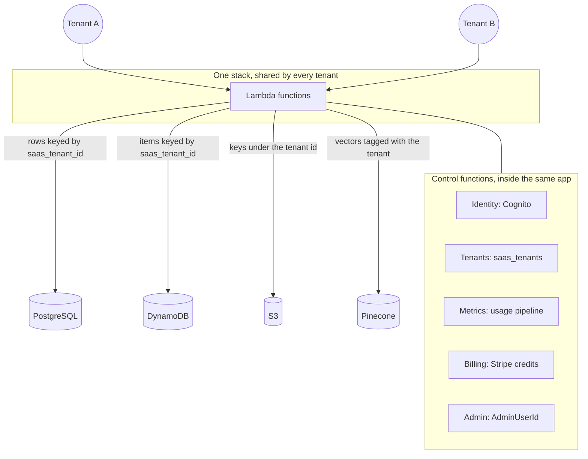

# Architecture

This document details the architecture the [README](../README.md) summarizes: every part the
stacks deploy, how one deployment serves every user, where the data lives and how the code is
laid out. Each section is a summary that links the topic document holding the detail.

**Contents:** [One body of code, several entry points](#one-body-of-code-several-entry-points) ·
[The entry points](#the-entry-points) ·
[Every user is a tenant of their own](#every-user-is-a-tenant-of-their-own) ·
[The LLM call](#the-llm-call) · [Storage](#storage) · [Codebase structure](#codebase-structure)

## One body of code, several entry points

API Gateway and Lambda serve the whole app: a WebSocket API carries every chat command and
pushes every change to the connected browsers, and REST APIs carry files, summaries, billing
and a service-to-service RAG endpoint. Nothing on the ECS cluster answers the browser; its EC2
host runs the Kafka broker the Lambdas publish usage to, the consumer that turns usage into
cost, and the PostgreSQL and Redis the Lambdas read and write
(ADR 0001).

The drawing leaves out Stripe and the billing function, Pinecone and the bucket processor that
feeds it, the RAG query API, SES and the commands event bus; it draws the functions in private
subnets, which the template supports but the deploy leaves unset
([The functions run outside a VPC](design-patterns.md#the-functions-run-outside-a-vpc)), and its
analytics consumer does not exist. The business logic lives in Lambda layers the functions share
([Shared code lives in layers](design-patterns.md#shared-code-lives-in-layers)),
so the WebSocket handlers, the REST functions and the queue workers run one body of code against
the same stores.

## The entry points

Every function runs Node.js 24 (`nodejs24.x`) with X-Ray tracing on, and writes to a log group
the template declares, `/aws/lambda/<stack>/<logical id>`, kept for `LogRetentionDays` (14).

**Entry points**, each route in [API endpoints](api.md):

- **WebSocket API** (`<stack>-WebSocketAPI`) — carries every chat command, routed by the
  `action` field of each message. An authorizer verifies the Cognito ID token on connect, and
  the connect and disconnect functions keep each user's connection ids in Redis.
  `WebsocketCommandsHandler` runs each command through the `commandsHandlers` layer and pushes
  each response to the connections of every user the change concerns.
- **REST API** (`<stack>-RestAPI`) — four functions, behind the Cognito user pool's authorizer
  but for two billing routes: `SummariesRestFunction` (summaries, their PDFs and a chat's
  attached files), `DocumentsRestFunction` (the tenant's RAG documents), `BillingFunction` (the
  credit packages and the Stripe purchase, [Billing](billing.md)) and
  `ControlPlaneRedisFunction` (the cache keys, for the admin user only).
- **RAG query API** (`<stack>-RagQueryAPI`) — answers another service's question from the
  documents of one configured tenant; the caller authenticates with an API key.

**Workers**, each one's steps, limits and retries in
[Workers' responsibilities and flows](workers.md):

- **`messagesToClientsQ`** feeds **`WebsocketEventsHandler`** — pushes the messages of the
  connect, disconnect and billing functions to their target connections, sends email, and
  publishes each data change to `<stack>-commands-event-bus`.
- **`chatSummarizerQ.fifo`** feeds **`ChatSummarizer`** — after each chat turn it writes a
  summary that folds in the chat's previous one and embeds it for semantic search.
- **`SummariesStreamProcessor`** — reads the Summaries table's stream: it renders a new summary
  to a PDF in S3 and removes a deleted summary's PDF.
- **`BucketProcessor`** — runs on every object created or removed in the summaries bucket: it
  writes a text copy of a file, and cuts a RAG document into chunks it embeds into Pinecone.
- **Usage service** (an ECS task) — consumes the usage Kafka topic and writes one costed row
  per LLM call ([Billing](billing.md#how-credit-is-spent), [ECS deployment](ecs-deployment.md)).

**Hosting and identity**

- **Frontend bucket and CloudFront distribution** — host the React app.
- **Summaries bucket and its CloudFront distribution** — hold uploaded files, RAG documents and
  summary PDFs ([S3](data-model.md#s3)).
- **Cognito** — the user pool is the shared `vsdb-cognito` stack's, with Google as the only
  identity provider; this stack adds an app client ([Sign-in](sign-in.md),
  ADR 0006).
- **Secrets Manager secret** `/<app>/app-secrets` (`AppSecretName`) — the OpenAI, Pinecone,
  OpenWeather and Stripe keys the functions read at run time; the main stack owns it.

## Every user is a tenant of their own

One deployment serves every user, and each user is a tenant of their own: every row, item, S3
key and Pinecone vector carries the owner's `saas_tenant_id`, the Cognito `sub`. No organization
signs up with members of its own, which is why the product is a web app with prepaid credits
rather than a SaaS with tenant administrators
(ADR 0002).

## The LLM call

A chat's LLM profile names its model, an OpenAI model or a Claude model on Bedrock
(ADR 0008). Before the call the backend adds
the matching chunks of the tenant's RAG documents to the prompt; the model may ask for the
weather tools, and it writes the answer with their results. Each call's token counts go to Kafka
([How a chat question is answered](domain-rules.md#how-a-chat-question-is-answered)).

## Storage

The relational data lives in PostgreSQL and the summaries in DynamoDB
(ADR 0003). Every table, key,
index and object layout is in [Data model](data-model.md).

- **PostgreSQL**, database `sum_db` on the ECS host — tenants and their credit, chats and
  their follow-up turns, who a chat is shared with, one usage row per LLM call, and the catalog
  of LLM profiles, prompts and prices.
- **DynamoDB**, table `<stack>-Summaries` — each chat's summaries, with a stream the PDF
  rendering reads.
- **S3**, the summaries bucket — summary PDFs, files attached to chats and RAG documents, each
  under its tenant's prefix.
- **Pinecone** — one index of summary embeddings and one of RAG chunks
  (ADR 0007).
- **Redis** — the query cache and the WebSocket connection registry, so losing it loses no data.

## Codebase structure

- `backend/lambdas/` — one folder per function package: `websockets/authorizer`,
  `websockets/connections` (connect, disconnect, commands and events handlers), `documents`
  (summaries and documents REST, the stream processor), `bucket-processor`, `chat-summarizer`,
  `billing`, `control-plane/redis`, `rag-query`.
- `backend/summaries-service/layers/` — the `commandsHandlers`, `dbData` and `redisClient`
  layers; `backend/layers/documents-utils` and `backend/lambdas/websockets/layers/connections`
  hold the rest.
- `backend/usage-service/` — the Kafka consumer and its Dockerfile.
- `backend/tests/` — Node test runner suites for the document ids, the RAG query contract and
  the stream processor.
- `frontend/` — the React app: `src/components/`, `src/redux/` (one folder per slice of
  state), `src/services/` (REST and Stripe clients), `src/locales/` (English and Hebrew).
- `data-types.ts`, `ws-messages.ts`, `rest-messages.ts` — the shared contracts
  ([One definition of each contract](design-patterns.md#one-definition-of-each-contract)).
- `scripts/` — the templates and the operations scripts ([Development](development.md)).
- `docs/` — this document, the topic documents and the ADRs under `docs/adr/`.
