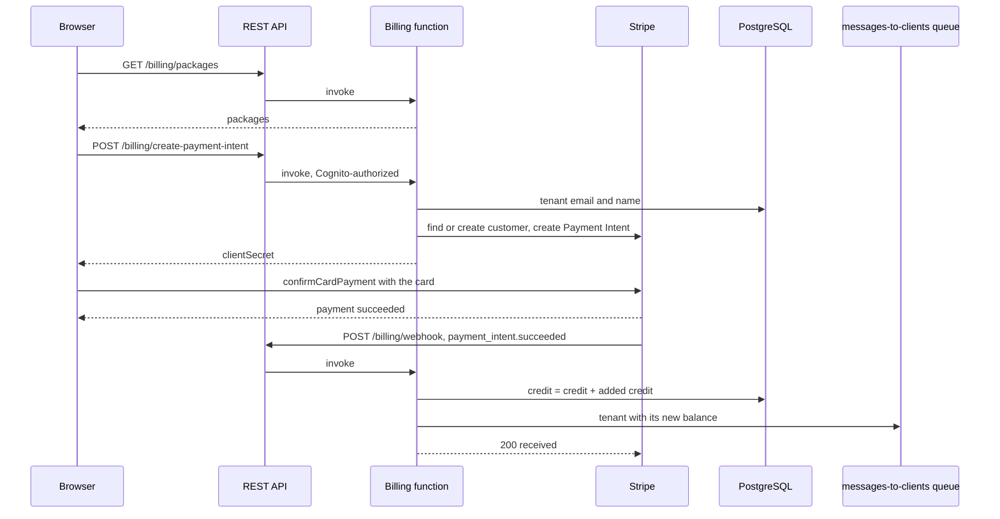

# Billing

This document details the credit purchase and the credit spending that the
[README](../README.md) and [Architecture](architecture.md) summarize: the packages, the billing
routes, the Stripe webhook that adds credit, and how each LLM call's cost is counted
against it ([ADR 0005](adr/0005-prepaid-credits-bought-through-stripe.md)).

**Contents:** [The parts](#the-parts) · [Packages](#packages) · [Routes](#routes) ·
[Purchase flow](#purchase-flow) · [How credit is spent](#how-credit-is-spent)

## The parts

- **Frontend** — `frontend/src/components/BillingSettings.tsx` (packages and balance),
  `PaymentForm.tsx` (the Stripe card form), `frontend/src/redux/billing/billingSlice.ts`, and
  `frontend/src/services/stripe.ts`, which loads Stripe.js with `STRIPE_PUBLISHABLE_KEY` from
  `appConfig.json`. `scripts/lib/app-config.sh` copies that key from the app secret.
- **`BillingFunction`** (`backend/lambdas/billing/billing.ts`) on the REST API.
- **`saas_tenants.credit`** in PostgreSQL — whole dollars, an integer.
- **Stripe** — Payment Intents, customers, and the webhook. The secret key and the webhook
  signing secret are read from the app secret in Secrets Manager.

## Packages

The packages, hardcoded in `CREDIT_PACKAGES` of `billing.ts`:

| Package id | Name | Price | Credit |
|---|---|---|---|
| `credits_20` | $20 Credits | $20 | $20 |
| `credits_60` | $60 Credits | $60 | $60 |

## Routes

- `GET /billing/packages` — no authorizer; returns the active packages.
- `POST /billing/create-payment-intent` — the Cognito authorizer; body `{ packageId }`. The
  function finds the tenant's email and name, reuses the Stripe customer with that email or
  creates one, and creates a Payment Intent of the package's price in cents (`usd`) whose
  metadata carries `userId`, `packageId` and `credit`. It answers
  `{ payload: { clientSecret } }`, or 404 for an unknown package.
- `POST /billing/webhook` — no authorizer; Stripe calls it. Its URL is
  `https://<rest-api-id>.execute-api.<region>.amazonaws.com/<stage>/billing/webhook`, entered
  in the Stripe dashboard with the events `payment_intent.succeeded` and
  `payment_intent.payment_failed`; the dashboard's signing secret goes into the app secret as
  `STRIPE_WEBHOOK_SECRET`.

## Purchase flow



The webhook handler:

1. Answers 400 when the `stripe-signature` header is missing.
2. Verifies the signature with `stripe.webhooks.constructEvent`. When verification fails, it
   parses the body and, if it has the shape of a Stripe event (`id`, `object: "event"`, `type`,
   `data`), handles it without a verified signature, logging a warning; any other body is a
   400. The code's reason is that API Gateway may reformat the body.
3. On `payment_intent.succeeded`, adds the metadata's credit to the tenant. A test payment (an
   id starting `pi_test_`, or not live mode) adds $1 instead, except for the internal accounts:
   the admin user and the tenant of `RagQueryTenantEmail` keep the full amount. It then queues
   the tenant's record with its usage, so the events handler pushes the new balance to the
   user's open connections.
4. On `payment_intent.payment_failed`, logs a warning.
5. Answers 200 `{ received: true }`.

Errors inside step 3 are logged and the handler still answers 200, so Stripe does not retry a
payment whose credit failed to land; the log line `Error handling payment succeeded` is the one
trace of it.

## How credit is spent

Every LLM call of a chat publishes its token counts to the `Summaries.AI-usage` Kafka topic,
with an operational fee of $0.05 on the main stack (`sum`) and none on a feature-branch stack.
The usage service writes one `usage_metrics` row per message with

```text
cost = prompt_tokens / 1,000,000 × input_cost_per_million
     + completion_tokens / 1,000,000 × output_cost_per_million
     + operational fee
```

from the `llm_pricing` row of the profile's model. When the profile or its price is missing,
the row is written with a cost of 0. Embedding calls are not metered.

The remaining credit is `credit` minus the sum of the tenant's `cost`. A new tenant starts with
$1. The browser refuses to send a new chat or turn while the remaining credit is zero or less
(`RecordForm.tsx`, `Subrecords.tsx`, `WebSocketService.tsx`); the backend does not check it.
