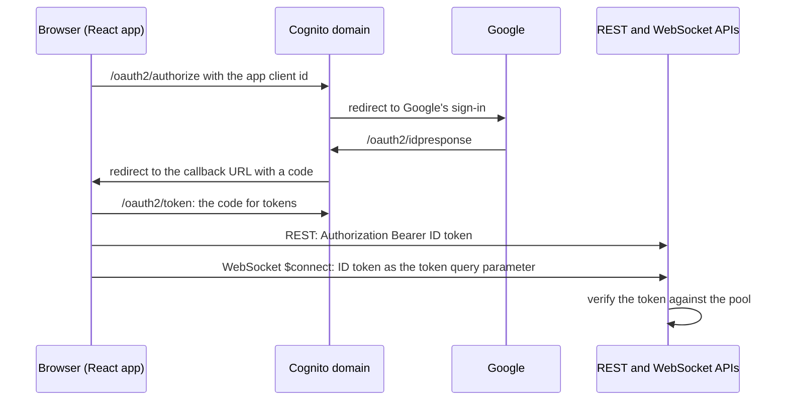

# Sign-in

People sign in to Summaries.AI with a Google account, through a Cognito user pool the app shares
with the other apps of the account. This page details the sign-in behind the Cognito entry of
[Architecture](architecture.md#the-parts): how it works, what the app adds to the shared pool
and how to set it up in a new account, and who may sign in.

## How it works

1. **The pool comes from vpc-subnets-sgs.** That repository deploys the stack `vsdb-cognito`: a
   user pool with Google as its identity provider, a hosted domain, and the Google OAuth
   client. Google redirects only to that domain, never to this app.
2. **The app adds an app client.** `scripts/template.yaml` creates `<stack>-UserPoolClient` on
   the pool, with no client secret, the authorization-code flow, the scopes `openid email
   profile phone`, and Google as its only provider. Its callback and sign-out URLs are the same
   two addresses:
   - `https://<distribution>.cloudfront.net`, the stack's output `CloudFrontUrl`, where
     `deploy.sh --frontend` publishes the app. With `CustomDomainName` set, `https://<custom
     domain>` takes its place, while the published frontend still redirects to the CloudFront
     address, which the app client then refuses.
   - `http://localhost:3000`, the React dev server.
3. **The browser runs the sign-in.** `frontend/src/index.tsx` configures `react-oidc-context`
   with the pool as its issuer, the app client id and the redirect address, all read from
   `frontend/src/appConfig.json`. `scripts/lib/app-config.sh` writes that file from the stack's
   outputs (`UserPoolId`, `UserPoolClientId`, `CognitoDomain`); `deploy.sh --frontend` builds
   the published frontend with the CloudFront address as its redirect, and every deploy then
   leaves the file at `http://localhost:3000` for local work. The sign-in button sends the
   browser to Cognito's hosted page, which offers Google.
4. **The APIs check the ID token.** The REST API's Cognito authorizer checks the
   `Authorization: Bearer` header on every route except `GET /billing/packages` and
   `POST /billing/webhook`. The WebSocket API's `$connect` authorizer verifies the token passed
   as the `token` query parameter against the pool. Both accept the ID token of any app client
   on the pool, not only this app's.
5. **Sign-out** drops the tokens in the browser and sends it to
   `https://<cognito domain>/logout` with the app client id and the sign-out address, which
   ends the Cognito session and returns to the app.

The Cognito `sub` of the signed-in user is their tenant id
([ADR 0006](adr/0006-google-sign-in-through-a-shared-cognito-user-pool.md)).

## Setting up Google

The Google side belongs to the shared pool: follow the section "Setting up Google" of
`docs/sign-in.md` in the vpc-subnets-sgs repository. It starts from no Google Cloud project and
ends with `vsdb-cognito` deployed, its Google client stored in Secrets Manager. Its redirect URI
is on the pool's domain, so this app adds nothing at Google.

What this app needs from the pool, in a new account:

1. **Deploy the pool first**, from vpc-subnets-sgs's `main`, in the region this app deploys to
   (`AWS_DEFAULT_REGION` in `scripts/lib/aws-config.sh`): the app's authorizer names the pool by
   an ARN in its own region and account.
2. **Name the pool.** In `scripts/lib/stack-params.sh`, set `ExistingUserPoolId` to the
   `UserPoolId` output of `vsdb-cognito`. `ExistingCognitoDomain` is built there as
   `vsdb-<account id>.auth.<region>.amazoncognito.com`, the `CognitoDomain` output of a pool
   deployed from vpc-subnets-sgs's `main`, so it needs no edit.
3. **Deploy the app** with `./scripts/deploy.sh --frontend`. The stack creates the app client
   with both callback addresses, and the frontend is published with its sign-in configured; no
   step in the Cognito console follows.

A feature-branch stack, `sum-fb`, gets an app client of its own on the same pool, with its own
CloudFront address.

## Who may sign in

Anyone the shared pool admits: while the Google app is in Testing, the test users of
vpc-subnets-sgs's Google project, a list every app on the pool shares. This app keeps no
allow-list. On a user's first connection the browser finds no tenant row and creates one, with
the starting credit of [Billing](billing.md).

One user is the admin, whose Cognito `sub` is the template parameter `AdminUserId`; the admin
reaches the control routes and sees the open connections. `stack-params.sh` does not pass it,
so the stack runs with the template's default, the `sub` of a user of the existing pool. In a
new pool nobody is admin until `AdminUserId` names a user's `sub`, which the Cognito console
shows under the pool's **Users** after that user's first sign-in.
